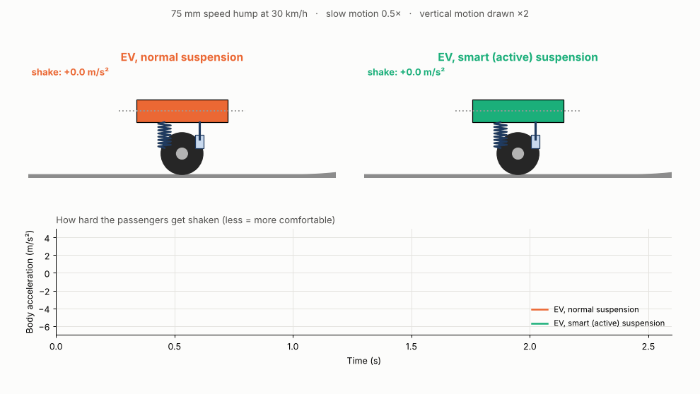
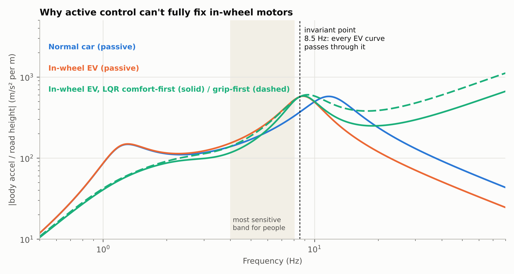
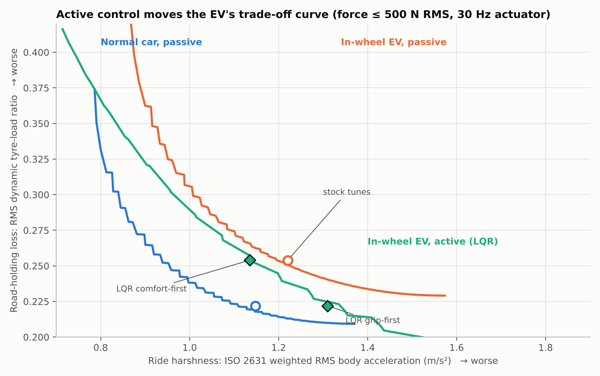

# In-Wheel-Motor EV: Ride Comfort & Road-Holding Case Study

**Can suspension control win back what in-wheel motors cost an electric car?**

In-wheel motors add roughly 30 kg to every wheel. This project models one corner of a C-segment compact car (the world's largest car segment), drives it over ISO 8608 random roads and a speed hump, scores it with the ISO 2631 comfort weighting, and compares passive, semi-active and active suspensions, then stress-tests the controllers on 100 car variants.



*75 mm speed hump at 30 km/h (slow motion 0.5×, vertical motion drawn ×2). Orange: in-wheel EV with normal suspension. Green: same EV with active (LQG) suspension.*

## Key results

| Finding | Number |
|---|---|
| Comfort / road-holding penalty of +30 kg per wheel (same springs and dampers) | **+6.3% / +14.5%** worse |
| Best passive re-tune of the EV vs best passive normal car, at equal grip | still **~31% harsher** |
| Active LQR (comfort-first): ride harshness vs stock EV, grip unchanged | **−7.2%** (1.208 → 1.121 m/s², normal car 1.139) |
| Active LQR (grip-first): road holding vs normal car | **matched** (0.221 vs 0.221), +7% harshness |
| Average actuator power / RMS force | **~23 W / ~220 N** |
| Speed hump peak jolt, active vs passive EV | **−34%**, settles in ~1 s instead of ~2.5 s |
| Stability across 100 random car variants (load, tyres, wear) | **100/100**, no actuator saturation |

**Why active control can't fix both comfort and grip:** at the tyre's own frequency √(k<sub>t</sub>/m<sub>u</sub>), no force acting between body and wheel can change body motion (the *invariant point*). In-wheel motors move it from 11.2 Hz down to **8.5 Hz**, next to the 4–8 Hz band people feel most. Verified numerically: the body response at 8.51 Hz is identical for every controller.



## Approach

| Phase | What was done |
|---|---|
| 1. Model | 2-DOF quarter-car, normal car vs in-wheel EV; natural frequencies, step and frequency response |
| 2. Roads & comfort | ISO 8608 random road (Class C, 80 km/h), speed hump; ISO 2631-1 W<sub>k</sub> weighting (checked to 0.13% vs the standard's table) |
| 3. Passive optimisation | 57 × 116 spring/damper sweep, Pareto fronts, `fminsearch` optimum |
| 4. Control | Semi-active skyhook and hybrid; **frequency-shaped, lag-aware LQR** (ISO filter and 30 Hz actuator inside the design); **LQG** with two noisy sensors and a Kalman filter; ±2.5 kN force limit |
| 5. Robustness | Monte Carlo over 100 variants (sprung mass −10…+30%, unsprung ±15%, tyre stiffness ±20%, damper wear 0…−20%), gains fixed |



## Engineering lessons (problems found and fixed)

1. **Optimise the metric you'll be judged on.** Standard LQR minimised unweighted acceleration and barely beat passive; putting the ISO W<sub>k</sub> filter inside the design fixed it.
2. **Model the hardware.** Forces were 4× higher in simulation than in design until the actuator lag was added to the design model.
3. **Look at time histories, not just RMS.** The MATLAB animation exposed sensor noise leaking into the actuator; a more conservative Kalman filter cut it 17× with no comfort loss.

## How to run (MATLAB, core only, no toolboxes)

```matlab
cd matlab
selfcheck            % verifies the building blocks (all PASS)
phase1_model         % model, frequencies, step/frequency response
phase3_optimise      % sweep, Pareto front, optimum passive tunes
phase4_control       % controllers, results table, speed hump plots
phase5_robustness    % 100-variant Monte Carlo (~5 min)
animate_hump         % side-by-side animation, saves media/hump_animation.gif
```

`verification_python/` holds an independent Python re-implementation used to cross-check the MATLAB results (identical speed-hump results, same design checks and robustness conclusions).

## Repository layout

```
matlab/                 MATLAB source (params, model, roads, metrics, controllers, phase scripts, animation)
media/                  Figures and the animation
docs/                   Full case-study report (PDF)
verification_python/    Independent Python cross-check
```

## Limitations

Quarter-car only (no pitch/roll/seat); unsprung mass and tyre stiffness are engineering estimates; ideal force actuator with a 30 Hz lag; LQR passes more vibration above ~15 Hz (a production design would add a roll-off filter); simulation only, real-world validation with accelerometer data is the next step. See the [full report](docs/InWheel_EV_Suspension_Case_Study.pdf).

---
*Independent simulation case study. Vehicle data: NHTSA measured corner weight for a C-segment sedan; in-wheel motor mass from the Lotus/Protean in-wheel-motor studies.*
